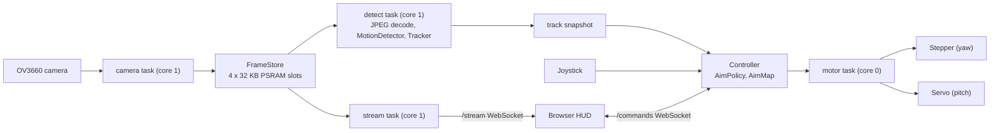

<div align="center">
  <div style="display: flex; align-items: center; justify-content: center; gap: 20px;">
    
    
  </div>

  <strong>An ESP32-CAM pan/tilt turret that tracks motion on-device and serves a live web HUD</strong>

  [](https://github.com/KoganTheDev/void-sentry-esp32/actions/workflows/ci.yml)
  [](https://github.com/KoganTheDev/void-sentry-esp32/actions/workflows/static_analysis.yml)
  [](https://github.com/KoganTheDev/void-sentry-esp32/actions/workflows/doxygen_docs_generator.yml)
  
  
  
</div>

<!-- DEMO GIF: record with the board (HUD + turret following), save as assets/demo.gif -->

## What it does

Void Sentry watches a room through an OV3660 camera on an ESP32, finds the moving object by frame differencing, and points a stepper-plus-servo turret at it. Everything runs on the board: no PC or cloud is involved. A browser HUD streams the live video over a WebSocket and shows tracking telemetry. The camera is fixed on the base and the turret aims absolutely: image position is mapped to pan/tilt angles through a two-point calibration you do with the joystick or from the HUD. The firmware is written in C++20 on the Arduino core, with the pure logic split into libraries that are unit-tested on the host.

## Highlights

- **Cheap detection path:** each QVGA JPEG is decoded at 1/8 scale (DC coefficients only) to a 40x30 grey grid in about 7 ms, versus about 71 ms at 1/4 scale.
- **Measured under load:** with a person close to the camera and the turret following, the worst 5 s window costs 11.4 ms per frame for decode plus tracking (25-30 ms in Stage 3, very likely caused by a HUD request storm, see the engineering notes), and every captured frame is analysed (83-84 per 5 s).
- **No per-frame allocation:** the camera task copies frames into 4 fixed 32 KB PSRAM slots; readers hold RAII leases, and a leased slot is never rewritten.
- **Dual-core by design:** core 1 runs camera copy, detection and control; core 0 runs network, the camera driver and the motor task. A 20 min soak showed no reboots and about 147 KB heap free (min 137 KB).
- **Smooth motion:** trapezoidal stepper profile at a 1 kHz motor tick (max 400 steps/s, accel 800 steps/s^2), rate-limited servo (120 deg/s), soft limits and a 2 s hold after the target is lost before returning home.
- **Tested off-device:** the pure logic is unit-tested on the host (also under ASan + UBSan, with coverage tracked per library in CI), plus a regression bench over recorded real clips and synthetic clips.
- **Hardware-driven fixes:** a camera clock change (20 MHz to 12 MHz) took ping from 265 ms to 19 ms, and a HUD request-loop bug that saturated core 0 was found with a purpose-built idle counter. Both are written up in [docs/engineering-notes.md](docs/engineering-notes.md).
- **Browser-origin checks on the WebSockets:** handshakes from another browser origin, or with a non-IPv4 Host header (DNS rebinding), are refused. Non-browser clients on the LAN are not authenticated yet.

## Architecture



Frames flow one way: camera, slots, detection, snapshot, controller, motors. The stream task reads the same slots for the HUD. `Controller` depends only on interfaces (`BaseDetectionModule`, `BaseTurret`), and objects are wired by reference in `src/main.cpp`.

httpd is pinned to core 0 so network bursts cannot preempt detection. The full task table (cores, priorities, stack sizes) is in [CLAUDE.md](CLAUDE.md), and the reasoning in the [engineering notes](docs/engineering-notes.md#7-dual-core-task-layout).

## Performance

Measured on the board (QVGA JPEG, quality 18, camera clock 12 MHz, about 16.6 fps capture).

| Measurement | Result |
|---|---|
| Decode, 1/8 scale DC-only vs 1/4 scale | about 7 ms vs about 71 ms |
| Per-frame decode + track, empty scene | 7.7-9.1 ms + 0.49-0.59 ms |
| Per-frame decode + track, person close, turret following (worst 5 s window) | 11.4 ms (Stage 3: 25-30 ms) |
| Frames analysed per 5 s | 83-84 (every captured frame) |
| 20 min soak | no reboots, heap about 147 KB free (min 137 KB) |
| Camera clock 20 MHz vs 12 MHz: ping | 265 ms vs 19 ms (capture 27.8 vs 16.6 fps) |

A higher camera clock degrades WiFi on this board, so 12 MHz is the best frame rate that keeps the network healthy. The full sweep is in the [engineering notes](docs/engineering-notes.md#3-camera-clock-speed-versus-wifi).

## Hardware and wiring

Parts: Freenove ESP32-WROVER CAM (OV3660, PSRAM required) on the Freenove GPIO Extension Board; 28BYJ-48 stepper with a ULN2003 driver (yaw); SG90 servo (pitch); 2-axis joystick with push button.

| Function | GPIO |
|---|---|
| Joystick X / Y (ADC1, works with WiFi on) | 32 / 33 |
| Joystick button | 0 |
| Servo (pitch) | 14 |
| Stepper IN1-IN4 (yaw) | 13, 12, 15, 2 |

With the camera attached exactly 8 GPIOs are free, and the turret uses all 8. `ESP32/include/pins.h` is the only place pins are defined, and its `static_assert`s reject flash/PSRAM pins, camera collisions and duplicates. GPIO12 high at reset selects 1.8 V flash and causes a boot loop, so check the ULN2003 polarity before powering on.

## Getting started

Prerequisites: [PlatformIO](https://platformio.org/) (CLI or the VS Code extension). The toolchain is Arduino core 3.3.12 (ESP-IDF 5.5.5, GCC 14) with C++20. The first build rebuilds the Arduino libraries because of `custom_sdkconfig` (20-40 minutes once, then 1-3 minutes).

1. From `ESP32/`, build, flash and watch the serial log:
   ```bash
   pio run -e freenove_esp32_wrover
   pio run -e freenove_esp32_wrover -t upload
   pio device monitor        # 115200 baud
   ```
2. Set up WiFi on the device (no credentials are compiled in). With no saved network in range, the board opens a WPA2 hotspot `VoidSentry-XXXX` and prints its password on the serial log. Join it from a phone, and the setup page opens (or browse to `http://192.168.4.1/wifi`). Save your network and choose a PIN. Up to 3 networks are kept in flash, and the strongest one in range is joined. Later changes go through the same page (linked from the HUD) and need the PIN. Typing `wifi-reset` in the serial monitor erases the saved networks, the PIN and the hotspot password (a new one is generated).
3. Read the board's IP address from the boot log. DHCP can hand out a new address after reflashing, so do not assume it.

`pio run -e pin_check -t upload` flashes a wiring bring-up test (no camera, no WiFi) and prints the result on serial.

## Using it

Open `http://<board-ip>/` in a browser. The page is served gzipped from flash and shows the live stream, a target overlay and telemetry.

- **Modes:** AI (the turret follows the tracked target), User (manual), Calibrate. The segmented AI / MANUAL / CALIBRATE control shows "switching..." until the board confirms. The HUD shows UNCALIBRATED until a map is saved. A short press of the joystick button toggles AI and User.
- **Jogging:** WASD, the arrow keys or the on-screen cross jog the turret in manual mode (resent every 100 ms, with a 300 ms dead man on the board). Slow / Normal / Fast sets the jog speed (holding Shift means slow). An arrow dims when the turret is at that end stop, and pressing it toasts. A deflected joystick always wins over the HUD.
- **Aiming at a point:** tap or drag on the video in manual mode and the turret goes there. Because the camera is fixed, the board knows which image point the turret points at and sends it, so the solid red reticle is the real aim. A dashed ghost reticle follows your finger instantly, with a dotted line and a time-left estimate, so the motor lag is visible instead of hidden. If the point is outside what the turret can reach, the ghost turns amber and shows where it will stop. The recenter button (or `H`) aims at the middle of the image.
- **Calibration:** from the HUD, press C (or the CALIBRATE segment) and follow the wizard: it checks that a target is locked and the turret is still, then records point 1 and point 2 near opposite corners of the view. Success is shown when the board saves. The joystick works too: hold the button for 1.5 s (holding it again cancels and restores the previous mode), aim at a spot near one corner and short-press, then the opposite corner and short-press. The map is stored in NVS with a CRC and loaded at boot.
- **FIRE:** a HUD effect only, there is no firing hardware (all free GPIOs are used). The tracer shows a HIT when the real reticle is inside the box of a locked target, otherwise a miss. Sentry auto-fire is opt-in: off by default, a confirm dialog arms it, a blinking chip shows while armed, and it disarms on link loss or reload. The board is never sent `fire:*`.
- **Status and tools:** chips for mode, video (fps, or `FROZEN n s` when frames stop, `BUSY` if you are a refused third viewer), link round trip, viewers (n/2, the board streams to 2) and calibration; a LOW LIGHT indicator; an event log drawer (filter, folded repeats); and a snapshot button (`P`) that saves the frame with the overlay as a PNG.
- **Phones:** the layout adapts to desktop, phone portrait (video, mode, controls with no scrolling) and phone landscape. Android gets vibration feedback on hits and end stops. iPhone has no Vibration API, so the HUD uses the iOS 17.4+ switch-checkbox click trick, which is best effort and may not work on newer iOS versions.

### Developing the HUD without hardware

`python tools/hud_mock/mock_board.py` runs a fake board that serves `web/*.html`, `/commands` and `/stream`; open `http://127.0.0.1:8080`. Flags are in its docstring. `web/test_web_ui.py` checks the page statically, and the visual reference is `docs/design/hud-mockup.html`.

## Testing and CI

```bash
pio test -e native                         # host unit tests, no board needed
pio test -e native_sanitize                # ASan + UBSan (Linux / CI)
pio check --severity=high --severity=medium   # cppcheck
python -m unittest discover -s tools/tracking -p "test_*.py"   # fixture tool tests
python -m unittest discover -s web -p "test_*.py"              # HUD generator and page tests
```

CI runs formatting, both firmware builds, the native tests under ASan + UBSan, per-library coverage (99% floor on the pure libraries), cppcheck, and a tracking bench that replays recorded and synthetic clips against `.expect` files and records cachegrind instruction counts per frame. Doxygen output is published to [GitHub Pages](https://koganthedev.github.io/void-sentry-esp32/) from `main`. On the board, the 5 s serial stats line reports heap, per-stage timings and per-core idle share.

## Project layout

```
ESP32/lib/tracking     motion detector and tracker (pure C++, host-tested)
ESP32/lib/aiming       AimMap, AimPolicy, calibration (pure C++, host-tested)
ESP32/lib/remote       HUD command parser and inbox (pure C++, host-tested)
ESP32/lib/frames       frame slot bookkeeping and leases (pure C++, host-tested)
ESP32/lib/provisioning WiFi plan, PIN guard, network list (pure C++, host-tested)
ESP32/lib/checksum     CRC-32 for the NVS blobs (pure C++, host-tested)
ESP32/lib/jpeg_gray    JPEG to 40x30 gray decode (pure wrapper, host-tested)
ESP32/lib/stats        windowed counters for the stats line (header-only, host-tested)
ESP32/lib/tjpgd        vendored JPEG decoder
ESP32/lib/frame_store  camera task and PSRAM slots
ESP32/lib/detection    detect task and tracking pipeline glue
ESP32/lib/controller   modes, joystick, ties detection to the turret
ESP32/lib/motion       turret, stepper and servo motor task
ESP32/lib/network      WiFi manager, HTTP/WebSocket server, stream broadcaster
ESP32/bench            tracking clip bench and fixtures
web/                   HUD source (web_ui.html) and header generator
tools/tracking/        clip recorder and fixture generator
docs/                  specs, plans and engineering notes
```

## Roadmap status

Stages 0 to 4b (tooling, camera stream, motion tracking, motion control, dual-core rework, HUD remote control), Stage 6 (on-device WiFi provisioning) and Stage 7 (Arduino core 3.x with C++20) are done. Stage 8 (refactor, test hardening and documentation clean-up) is in progress. The HUD UI/UX overhaul (design in `docs/superpowers/specs/2026-10-26-hud-ux-overhaul-design.md`) is implemented, natively tested and exercised against the mock board. Implemented but not yet verified on hardware: calibration save and reload across a reboot, HUD jogging in a browser (the protocol and dead man were checked from a PC client), HUD calibration, tap-to-aim, and the new status fields (reticle position, reach box, viewer count).

More detail: [engineering notes](docs/engineering-notes.md) (design decisions and debugging stories) and the [API documentation](https://koganthedev.github.io/void-sentry-esp32/).

## License

MIT, see [LICENSE](LICENSE).
