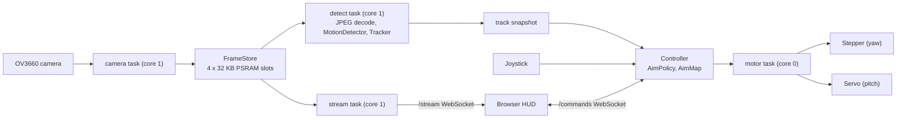
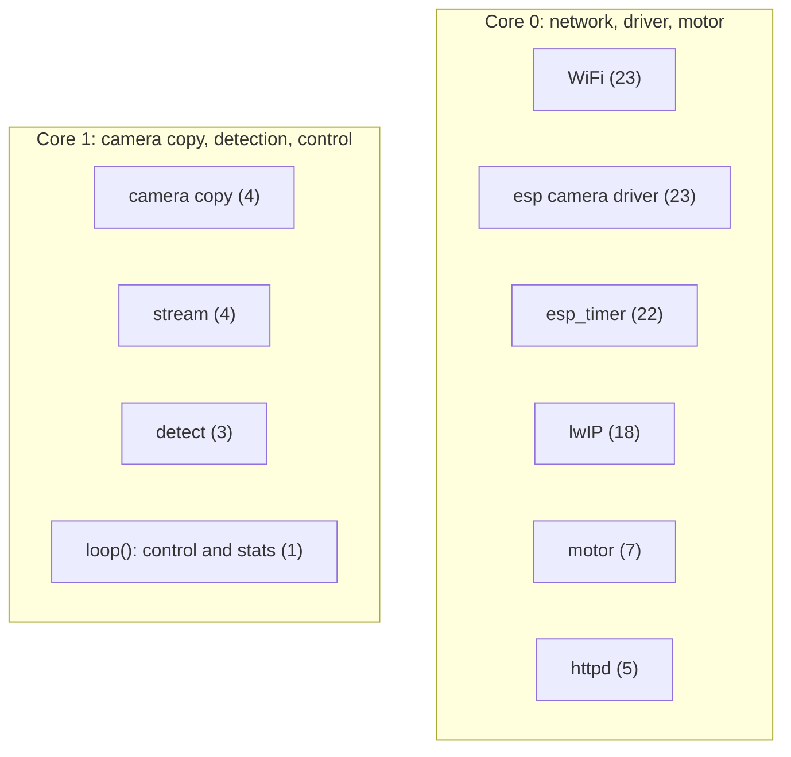

<div align="center">
  <div style="display: flex; align-items: center; justify-content: center; gap: 20px;">
    
    
  </div>

  <strong>An ESP32-CAM pan/tilt turret that tracks motion on-device and serves a live web HUD</strong>

  [](https://github.com/KoganTheDev/void-sentry-esp32/actions/workflows/ci.yml)
  [](https://github.com/KoganTheDev/void-sentry-esp32/actions/workflows/static_analysis.yml)
  [](https://github.com/KoganTheDev/void-sentry-esp32/actions/workflows/doxygen_docs_generator.yml)
  
  
  
</div>

<!-- DEMO GIF: record with the board (HUD + turret following), save as assets/demo.gif -->

## What it does

Void Sentry watches a room through an OV3660 camera on an ESP32, finds the moving object by frame differencing, and points a stepper-plus-servo turret at it. Everything runs on the board: no PC or cloud is involved. A browser HUD streams the live video over a WebSocket and shows tracking telemetry. The camera is fixed on the base and the turret aims absolutely: image position is mapped to pan/tilt angles through a two-point calibration you do with the joystick. The firmware is written in C++17 on the Arduino core, with the pure logic split into libraries that are unit-tested on the host.

## Highlights

- **Cheap detection path:** each QVGA JPEG is decoded at 1/8 scale (DC coefficients only) to a 40x30 grey grid in about 7 ms, versus about 71 ms at 1/4 scale.
- **Measured under load:** with a person close to the camera and the turret following, the worst 5 s window costs 11.4 ms per frame for decode plus tracking (25-30 ms before the dual-core rework), and every captured frame is analysed (83-84 per 5 s).
- **No per-frame allocation:** the camera task copies frames into 4 fixed 32 KB PSRAM slots; readers hold RAII leases, and a leased slot is never rewritten.
- **Dual-core by design:** core 1 runs camera copy, detection and control; core 0 runs network, the camera driver and the motor task. A 20 min soak showed no reboots and about 147 KB heap free (min 137 KB).
- **Smooth motion:** trapezoidal stepper profile at a 1 kHz motor tick (max 400 steps/s, accel 800 steps/s^2), rate-limited servo (120 deg/s), soft limits and a 2 s hold after the target is lost before returning home.
- **Tested off-device:** 132 host unit tests, also run under ASan + UBSan in CI, plus a regression bench over recorded real clips and synthetic clips.
- **Hardware-driven fixes:** a camera clock change (20 MHz to 12 MHz) took ping from 265 ms to 19 ms, and a HUD request-loop bug that saturated core 0 was found with a purpose-built idle counter. Both are written up in [docs/engineering-notes.md](docs/engineering-notes.md).
- **Secure-by-default WebSockets:** handshakes from another browser origin, or with a non-IPv4 Host header (DNS rebinding), are refused.

## Architecture



Frames flow one way: camera, slots, detection, snapshot, controller, motors. The stream task reads the same slots for the HUD. `Controller` depends only on interfaces (`BaseDetectionModule`, `BaseTurret`), and objects are wired by reference in `src/main.cpp`.



Numbers in brackets are FreeRTOS priorities. httpd is pinned to core 0 so network bursts cannot preempt detection.

## Performance

Measured on the board (QVGA JPEG, quality 18, camera clock 12 MHz, about 16.6 fps capture).

| Measurement | Result |
|---|---|
| Decode, 1/8 scale DC-only vs 1/4 scale | about 7 ms vs about 71 ms |
| Per-frame decode + track, empty scene | 7.7-9.1 ms + 0.49-0.59 ms |
| Per-frame decode + track, person close, turret following (worst 5 s window) | 11.4 ms (Stage 3: 25-30 ms) |
| Frames analysed per 5 s | 83-84 (every captured frame) |
| Tracking in internal RAM vs PSRAM | 0.6 ms vs 1.1 ms (pipeline about 12.6 KB) |
| Detect task stack | 2,496 B free of 4,096 |
| 20 min soak | no reboots, heap about 147 KB free (min 137 KB) |
| Camera clock 20 MHz: ping / 14 KB page fetch / fps | 265 ms / 1.1-5.0 s / 27.8 fps |
| Camera clock 12 MHz: ping / 14 KB page fetch / fps | 19 ms / 0.07-0.13 s / 16.6 fps |

A higher camera clock means more clock and DMA activity that degrades WiFi, so 12 MHz is the best frame rate that keeps the network healthy.

## Hardware and wiring

Parts: Freenove ESP32-WROVER CAM (OV3660, PSRAM required) on the Freenove GPIO Extension Board; 28BYJ-48 stepper with a ULN2003 driver (yaw); SG90 servo (pitch); 2-axis joystick with push button.

| Function | GPIO |
|---|---|
| Joystick X / Y (ADC1, works with WiFi on) | 32 / 33 |
| Joystick button | 0 |
| Servo (pitch) | 14 |
| Stepper IN1-IN4 (yaw) | 13, 12, 15, 2 |

With the camera attached exactly 8 GPIOs are free, and the turret uses all 8. `ESP32/include/pins.h` is the only place pins are defined, and its `static_assert`s reject flash/PSRAM pins, camera collisions and duplicates. GPIO12 high at reset selects 1.8 V flash and causes a boot loop, so check the ULN2003 polarity before powering on.

## Getting started

Prerequisites: [PlatformIO](https://platformio.org/) (CLI or the VS Code extension). The toolchain is Arduino core 2.0.17 (ESP-IDF 4.4, GCC 8.4) with C++17.

1. Create the WiFi credentials header (`ESP32/include/secrets.h`, copied from `ESP32/include/secrets.h.example`) and set your network name and password. It is gitignored; never commit it.
2. From `ESP32/`, build, flash and watch the serial log:
   ```bash
   pio run -e freenove_esp32_wrover
   pio run -e freenove_esp32_wrover -t upload
   pio device monitor        # 115200 baud
   ```
3. Read the board's IP address from the boot log. DHCP can hand out a new address after reflashing, so do not assume it.

`pio run -e pin_check -t upload` flashes a wiring bring-up test (no camera, no WiFi) and prints the result on serial.

## Using it

Open `http://<board-ip>/` in a browser. The page is served gzipped from flash and shows the live stream, a target overlay and telemetry.

- **Modes:** AI (the turret follows the tracked target), User (manual), Calibrate. The HUD shows UNCALIBRATED until a map is saved.
- **Joystick:** a short press of the button toggles AI and User; holding it for 1.5 s enters calibration, or cancels it and restores the previous mode.
- **HUD controls:** the mode button toggles AI and manual. In manual mode, WASD, the arrow keys or the on-screen buttons jog the turret (resent every 100 ms, with a 300 ms dead man on the board). A deflected joystick always wins over the HUD.
- **Calibration:** hold the button for 1.5 s, aim at a spot near one corner of the view and short-press, then aim at the opposite corner and short-press. The map is stored in NVS with a CRC and loaded at boot.

## Testing and CI

```bash
pio test -e native                         # host unit tests (132), no board needed
pio test -e native_sanitize                # ASan + UBSan (Linux / CI)
pio check --severity=high --severity=medium   # cppcheck
python -m unittest discover -s tools/tracking -p "test_*.py"   # fixture tool tests
python -m unittest discover -s web -p "test_*.py"              # HUD generator tests
```

CI (`ci.yml`) checks clang-format 19, builds both firmware environments, runs the native tests, the sanitizer job and the tracking bench. The bench replays recorded clips (`real_cross_room`, `real_hand_pause`, `real_light_switch`) and four synthetic clips against `.expect` files, regenerates the synthetic fixtures byte-for-byte and records cachegrind instruction counts. cppcheck blocks on warning-level findings in `static_analysis.yml`. Doxygen output is published to [GitHub Pages](https://koganthedev.github.io/void-sentry-esp32/) from `main`. On the board, the 5 s serial stats line reports heap, per-stage timings and per-core idle share.

## Project layout

```
ESP32/lib/tracking     motion detector and tracker (pure C++, host-tested)
ESP32/lib/aiming       AimMap, AimPolicy, calibration (pure C++, host-tested)
ESP32/lib/remote       HUD command parser and inbox (pure C++, host-tested)
ESP32/lib/frames       frame slot bookkeeping and leases (pure C++, host-tested)
ESP32/lib/frame_store  camera task and PSRAM slots
ESP32/lib/detection    JPEG decode and detect task glue
ESP32/lib/controller   modes, joystick, ties detection to the turret
ESP32/lib/motion       turret, stepper and servo motor task
ESP32/lib/network      WiFi, HTTP/WebSocket server, stream broadcaster
ESP32/bench            tracking clip bench and fixtures
web/                   HUD source (web_ui.html) and header generator
tools/tracking/        clip recorder and fixture generator
docs/                  specs, plans and engineering notes
```

## Roadmap status

Stages 0 to 4b (tooling, camera stream, motion tracking, motion control, dual-core rework, HUD remote control) are done. Stage 5 (this documentation) is in progress. Implemented but not yet verified on hardware: calibration save and reload across a reboot, and HUD jogging in a browser (the protocol and dead man were checked from a PC client). Next: on-device WiFi provisioning, and a move to Arduino core 3.x for C++20.

More detail: [engineering notes](docs/engineering-notes.md) (design decisions and debugging stories) and the [API documentation](https://koganthedev.github.io/void-sentry-esp32/).

## License

MIT, see [LICENSE](LICENSE).
