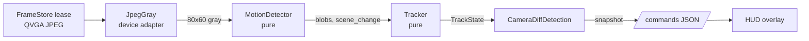

# Void Sentry Stage 2: Motion Detection and Persistent Tracking

Date: 2026-10-12. Status: approved in chat (approach A, sections 1-2, summary of 3-4).

## Goal

Find moving objects in the camera frames and keep a persistent lock on one target (stable id, short memory), shown on the web HUD. The turret does **not** move in AI mode in this stage; aiming (and the move/settle/re-acquire logic) is Stage 3.

Scene: indoor desk/room demo, targets 1-3 m away (a hand, a person crossing the room, a toy), indoor lighting.

## Decisions

| Decision | Choice | Why | Rejected |
|---|---|---|---|
| Pixel source | Decode the camera JPEG at 1/4 scale with `esp_jpg_decode(..., JPG_SCALE_4X, ...)` (ROM TJpgDec) straight into an 80x60 gray grid | No big RGB buffer, no per-frame malloc, averaging is a free noise filter, streaming keeps the camera's JPEG | Camera in gray/YUV + software JPEG for the stream (encode cost, undoes Stage 1); full-size RGB888 decode (230 KB, 16x the pixels needed) |
| Background | Exponential moving average, `bg += (frame - bg) / 16`, `uint16_t` Q8 fixed point | Shows the whole object, not just its edges; sees slow motion | Previous-frame diff (edges only, misses slow motion); selective update under the target (ghosts, YAGNI) |
| Target | Single persistent track: largest blob confirmed over 3 frames, then sticky | Ignores flicker; does not jump to a bigger distraction | Centroid of all motion (aims between two movers); largest blob per frame (jumps) |
| Prediction | Alpha-beta filter (constant velocity, fixed gains) | Steady-state Kalman with fixed gains; one target, position-only measurement | Full Kalman (covariance math buys nothing here) |
| Where it runs | In `loop()` via `Controller`, once per new frame (as today) | No new task or sync; dual-core split is Stage 4 | New detection task now |

## Architecture

### Pure library `lib/tracking` (namespace `tracking`, no Arduino/ESP-IDF headers, native + sanitizer tested)

Constants: `kGridW = 80`, `kGridH = 60`, `kCells = 4800`. All state is fixed-size members; no heap anywhere.

`GrayFrame`: `std::array<uint8_t, kCells>`, row-major.

`DetectorConfig` (defaults): `diff_threshold = 20`, `bg_shift = 4` (alpha 1/16), `scene_change_fraction = 0.35f`, `warmup_frames = 8`, `min_blob_cells = 6`, `max_blobs = 16`.

`MotionDetector::process(const GrayFrame&) -> const DetectionResult&`:
1. First frame or after reset: `bg = frame` (Q8), start warm-up, return no blobs.
2. Foreground mask: `|gray - bg| > diff_threshold`.
3. 3x3 binary opening (erode then dilate) to remove isolated cells. Grid border cells treat outside as background.
4. Scene-change guard: if foreground cells (before opening) exceed `scene_change_fraction * kCells`, set `scene_change = true`, reset `bg = frame`, restart warm-up, return no blobs.
5. During warm-up: update bg, return no blobs.
6. Blobs: two-pass connected components, 8-connectivity, union-find on fixed arrays (`uint16_t` labels, `kCells` capacity). Per blob: bounding box (x0, y0, x1, y1 inclusive, cells), area (cells), centroid (float, cells). Drop blobs under `min_blob_cells`; keep the `max_blobs` largest, sorted by area descending.
7. Update bg with the EMA for every cell (after detection, so a new object is detected before it starts to blend in).

`DetectionResult`: `scene_change`, `warming_up`, `foreground_cells`, `blob_count`, `std::array<Blob, 16> blobs`.

`TrackerConfig` (defaults): `confirm_frames = 3`, `coast_frames = 17` (~1 s at 17 fps), `alpha = 0.5f`, `beta = 0.2f`, `gate_margin_min = 4` (cells), `gate_margin_frac = 0.5f` (of target width/height), `velocity_decay = 0.8f`, `coast_gate_growth = 1` (cells per coasted frame).

`Tracker::update(const DetectionResult&) -> const TrackState&`, states `Idle`, `Tentative`, `Locked`, `Coasting`:
- **Idle:** if any blob, start `Tentative` on the largest (position = its centroid, velocity 0, box = its box, hits = 1).
- **Gate:** predicted box (`box shifted by velocity`) grown by `max(gate_margin_min, gate_margin_frac * box size)` on each side, plus `coast_gate_growth * frames_since_seen` while coasting.
- **Measurement:** union (bounding box, area sum, area-weighted centroid) of all blobs whose box overlaps the gate. None overlap = miss.
- **Tentative:** match increments hits; at `confirm_frames` go `Locked` and assign `id = ++last_id` (ids start at 1, never reused). A miss returns to `Idle` (no id consumed).
- **Locked:** match updates the alpha-beta filter (`pred = pos + vel; r = meas - pred; pos = pred + alpha*r; vel += beta*r`) and the box (box size smoothed with alpha, box re-centred on `pos`). Larger blobs outside the gate are ignored (stickiness). A miss goes `Coasting`.
- **Coasting:** each frame `pos += vel; vel *= velocity_decay; frames_since_seen++`. A match returns to `Locked` with the **same id**. After `coast_frames` misses go `Idle`.
- **Scene change:** a `Locked` target goes `Coasting`; `Tentative` goes `Idle`. Warm-up frames (no blobs) count as misses.

`TrackState`: `state`, `id` (0 when none), box (cells), `cx`, `cy`, `vx`, `vy` (cells, cells/frame), `frames_since_seen`, `area`. Helper to scale to the frame size (x4 for QVGA).

`direction_for(const TrackState&, deadzone_cells = 5) -> (MoveX, MoveY)`: Left/Right/Up/Down of the grid centre when `Locked` (or Coasting), None otherwise. Kept for Stage 3; uses `move_types.h` (header-only, native-safe).

### Device side

- **`JpegGray`** (`lib/tracking_device` or inside `lib/detection`): `bool decode(const uint8_t* jpeg, size_t len, tracking::GrayFrame& out)` using `esp_jpg_decode(len, JPG_SCALE_4X, reader, writer, ctx)`. The writer converts each RGB888 pixel to luma `(77R + 150G + 29B) >> 8` into `out`. Rejects frames whose scaled size is not 80x60. **Verify early** whether `esp_jpg_decode` allocates per call; if it does, measure heap behaviour and document (or switch to the ROM `jd_prepare`/`jd_decomp` with a static work buffer).
- **`CameraDiffDetection`** rebuilt: owns `JpegGray`, `MotionDetector`, `Tracker`; `detect_object()` decodes, processes, updates, records timings, publishes a snapshot, and returns `direction_for(track)`. The dead commented-out code and the unused members (`_prev_frame`, `_curr_frame`, `_diff_buffer`, `find_motion`, `jpeg_to_greyscale`, static-local `calculate_fps`) are removed.
- **Cross-task snapshot:** today the `/commands` handler (httpd task) calls `get_motion_data()` while `loop()` writes it (a data race). The detection module publishes a small POD snapshot (track state, box and centroid in QVGA pixels, velocity, timings, counters) under a `portMUX`/mutex; the handler copies it out. `MotionData` is extended or replaced accordingly.
- **Controller:** in AI mode, detection runs per new frame as now, but `move_relative()` is not called (a single `constexpr bool kAiAimEnabled = false` in the controller; Stage 3 flips it).
- **`/commands` JSON** (keep existing keys for compatibility, add new ones): `{"detected":0|1,"x","y","width","height","pixels","state":"idle|tentative|locked|coasting","id","bx","by","bw","bh","vx","vy"}` (QVGA pixels; `detected` = Locked or Coasting).
- **HUD** (`web/web_ui.html`): draw the target box and `#id` on the overlay canvas (solid when Locked, dashed when Coasting, nothing otherwise), show the state text in the lock indicator.
- **Stats line** adds `decode_us_avg`, `track_us_avg` (detector + tracker), `scene_changes`, `track_state`, `track_id`.

## Testing

**Native + `native_sanitize` (Unity, `test/native/test_tracking*`), synthetic frames, exact assertions:**
- Detector: static scene -> no blobs after warm-up; a bright rectangle appearing -> one blob with the exact box/area; single-cell noise removed by the opening; two separated rectangles -> two blobs sorted by area; a U-shape -> one blob (8-connectivity and union-find merge); full-frame brightness step -> `scene_change`, bg reset, warm-up; a static object blends into bg over time; a blob touching the grid border.
- Tracker: object moving at constant velocity -> `Locked` after exactly `confirm_frames`, id 1, centroid within 1 cell; a one-frame blob -> never locks, no id consumed; target pauses (no blobs) for 10 frames then reappears near prediction -> same id; gone for > `coast_frames` -> `Idle`, next lock gets id 2; locked target plus a bigger blob elsewhere -> stays on the target; target split into 2 blobs inside the gate -> one merged measurement; scene change while locked -> Coasting, then reacquire.
- `direction_for` deadzone and sign conventions.
- Clip regression (host): run the recorded clips through detector + tracker; assert no crash, no sanitizer report, and per-clip expectations recorded alongside the fixture (e.g. "locks within N frames, at most 1 id over the clip").

**Recorded fixtures:**
- `tools/record_stream.py`: connects to `ws://<ip>/stream`, saves N seconds of JPEG frames.
- `tools/jpeg_to_gray.py`: Pillow `draft("L", (80, 60))` (libjpeg DCT scaling, close to TJpgDec's) -> one `<clip>.gray` file of concatenated 4800-byte frames, plus `<clip>.json` (frame count, source, expectations).
- 3 clips of about 6 s each (~0.5 MB each), committed under `ESP32/test/fixtures/tracking/`: hand waving and stopping, person crossing the room, light switched on/off.

**Host benchmark (CI job `tracking-bench`):** a small `-O2 -g -fno-omit-frame-pointer` program runs each clip and prints instructions per frame with `perf stat -e instructions`. If `perf` is not usable on GitHub's runners, fall back to `valgrind --tool=cachegrind` instruction counts (deterministic). Numbers go in the PR description.

## Success criteria (on hardware)

| Criterion | Target |
|---|---|
| Decode + detect + track time | `decode_us_avg + track_us_avg` <= 15 ms |
| Capture / stream rate | >= 16 fps capture, HUD fps unchanged vs Stage 1 |
| Memory | `heap_min`, `psram_min` flat over a 10 min soak; no per-frame allocation on the detection path |
| Lock time | hand entering the view is `Locked` within ~0.3 s (about 5 frames) |
| Persistence | same id after the hand pauses for 1 s and moves again |
| Robustness | light switched on/off: no false lock (scene change counted) |
| Logic | all native tests pass, also under ASan + UBSan in CI |

## Out of scope

Moving the turret in AI mode, ego-motion handling, multiple simultaneous tracks, the HUD's manual-control commands (`move:`, `fire:`, `mode:`), detection on core 0, the `/commands` per-message 256-byte malloc (noted, unchanged), WiFi provisioning.
