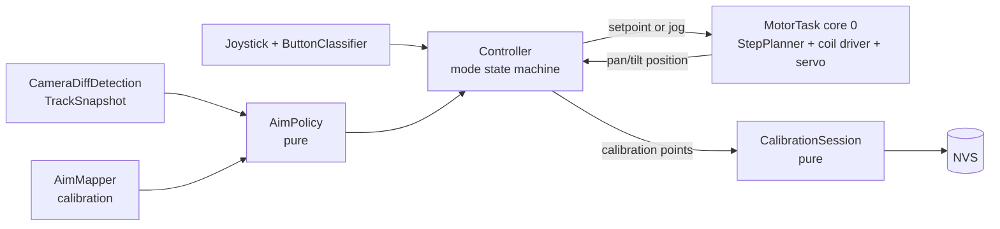

# Void Sentry Stage 3: Motion Control (Fixed Camera, Absolute Aiming)

Date: 2026-10-13. Status: approved in chat (fixed camera + absolute aim, joystick 2-point calibration, hold-then-home, motor task).

## Goal

In AI mode, point the turret at the tracked target. The camera is **not** mounted on the turret and stays fixed, so aiming is open-loop: map the target's image position to pan/tilt angles through a calibration, then move the motors to those angles. Motor motion must never stall detection.

## Why absolute aiming (not visual servoing)

With the camera on the turret, "target left of centre -> step left" converges, because each step shifts the image. With a fixed camera the image never moves when the turret moves. The target stays left of centre, and that loop would spin forever. So Stage 2's `direction_for()` is not used for aiming. A fixed camera also removes ego-motion: detection never has to pause while the turret moves.

The cost is that nothing in the image confirms where the turret points. Accuracy depends on the calibration and on the stepper not skipping steps. The user checks it by eye or with a pointer on the turret.

## Decisions

| Decision | Choice | Why | Rejected |
|---|---|---|---|
| Aiming | Absolute: target pixel -> (pan deg, tilt deg) via a per-axis linear map | Fixed camera; no image feedback | Visual servoing (diverges with a fixed camera); support both (double the code) |
| Calibration | Joystick 2-point calibration, saved to NVS; built-in default map until calibrated | Absorbs FOV, mounting angle and offset in ~1 min | Constants only (inaccurate unless co-located); HUD calibration (needs `/commands` move parsing) |
| Motor drive | Dedicated motor FreeRTOS task on core 0 owns stepper + servo; `loop()` only publishes setpoints | Detection never waits on motors; smooth acceleration | Stepping from `loop()` (stutters behind ~12 ms detection); timer ISR (riskier shared state) |
| Stepper driver | Own 4-phase full-step coil driver (sequence IN1, IN3, IN2, IN4 as wired today), coils released after 500 ms idle | Non-blocking single steps; cuts the 28BYJ's idle heating | Arduino `Stepper` library (`step(n)` busy-waits) |
| Motion profile | Trapezoidal velocity profile at a 1 kHz tick: max 400 steps/s, accel 800 steps/s^2 | Smooth starts and stops; no skipped steps on the 28BYJ-48 | Constant speed (jerky, skips steps at start) |
| No target | Hold 2 s after the track goes Idle, then return home slowly | Calm behaviour; home is a known pose | Hold forever; sweep (cosmetic with a fixed camera) |

## Coordinates and limits

- Pan: degrees, 0 = home (the stepper position at boot), positive = right. Stepper: 2048 full steps per revolution (0.1758 deg/step). Soft limits +-90 deg.
- Tilt: servo degrees. Home 90 deg, soft limits [20, 160] deg (protects the linkage).
- Image: QVGA pixels from the Stage 2 `TrackSnapshot` (x 0..319, y 0..239).

## Architecture

### Pure library `lib/aiming` (namespace `aiming`; no Arduino/ESP-IDF headers, no heap; native + ASan/UBSan tested)

- **`AimMap`** `{ float pan_a, pan_b, tilt_a, tilt_b; }`: `pan_deg = pan_a * x + pan_b`, `tilt_deg = tilt_a * y + tilt_b`. Each axis depends only on its own image axis; camera roll is ignored.
  - `default_map()`: assumes the camera sits next to the turret looking the same way. Horizontal FOV 66 deg over 320 px, vertical 50 deg over 240 px. Image centre maps to (pan 0, tilt 90). Image right means pan right; image down means tilt down.
  - `fit(p1, p2) -> optional<AimMap>`: each point is `{x, y, pan_deg, tilt_deg}`. Rejected if `|x1 - x2| < 80` px or `|y1 - y2| < 60` px, because a fit from points too close together amplifies error.
  - `aim(x, y) -> {pan, tilt}`, clamped to the soft limits.
- **`CalibrationBlob`**: `serialize(AimMap) -> std::array<uint8_t, N>` and `deserialize(...) -> optional<AimMap>`. The layout is a magic number, a version, four floats and a CRC-32. Unknown versions, bad CRCs and non-finite values are rejected.
- **`StepPlanner`**: a 1 kHz tick planner over integer step positions.
  - `set_target(steps)` and `set_velocity(steps_per_s)` for jog mode.
  - `tick() -> int` returns -1, 0 or +1: the step to emit this tick.
  - Trapezoidal profile: it never exceeds max speed or acceleration. It decelerates to stop exactly on the target, with no overshoot. A target change mid-move, including a reversal, is handled through deceleration and never by an instant direction flip at speed.
  - `position()`, `speed()`, `is_idle()`.
- **`AimPolicy`**: given a `TrackView {state, x, y}` and `now_ms`, it outputs `{kind: Hold | Aim | Home, pan, tilt}`.
  - Locked or Coasting: Aim at `map.aim(x, y)`, with a deadband. The setpoint changes only when the new aim differs from the current setpoint by more than 1 deg on either axis.
  - Tentative: Hold.
  - Idle: Hold until 2000 ms after the last Locked/Coasting frame, then Home.
- **`ButtonClassifier`**: turns debounced press/release edges and timestamps into `Short` (released before 1500 ms) or `Long` (still held at 1500 ms; fires once, when the threshold is crossed) events.
- **`CalibrationSession`**: a state machine `Idle -> WaitPoint1 -> WaitPoint2 -> Done | Failed`.
  - `record(x, y, pan, tilt, target_visible)`: a press with no visible Locked or Coasting target is ignored and the step does not advance.
  - After point 2 it calls `fit`. Success gives `Done` with the map; a rejected fit gives `Failed` with a reason.
  - `cancel()` returns it to Idle.

### Device side

- **Motor task** (`lib/motion`, rewritten): core 0, priority 3, 1 ms period (`vTaskDelayUntil`).
  - It owns the `StepPlanner`, the coil driver (4 GPIOs from `pins.h`) and the servo.
  - Each tick it applies the latest setpoint, then emits at most one step.
  - It releases the coils after 500 ms idle and re-energizes them on the next step. On re-energizing it writes the current phase before stepping, so it does not lose a step.
  - Servo: rate-limited to 120 deg/s, written at 50 Hz.
  - Interface (thread-safe, short critical sections): `set_target_deg(pan, tilt)`, `jog(pan_speed, tilt_speed)` (manual), `home()`, `position_deg() -> {pan, tilt}`, `zero_here()`.
  - The `Stepper` library dependency is removed. `BaseMovementManager` / `move_relative()` are replaced by this interface; the controller is the only caller.
- **Controller modes:** `AI` (default), `USER`, `CALIBRATE`.
  - Short press toggles AI and USER, as today; detection resets on every toggle.
  - Long press enters CALIBRATE from either mode, and cancels it while in CALIBRATE.
  - AI: once per new frame, detection runs, then `AimPolicy` runs and the controller sends `set_target_deg` / `home`.
  - USER and CALIBRATE: joystick deflection maps to `jog` speeds, at 25 Hz as today.
  - CALIBRATE also keeps detection running, so the HUD shows the target box.
  - In CALIBRATE a short press records a point with the current snapshot and the motor position. When the session reaches Done, the map is saved to NVS, applied immediately, and the mode returns to AI.
  - Home is the stepper position at boot. To re-home, the user jogs the turret to the desired home in USER mode and reboots. There is no button gesture for it: a double press would collide with the short-press mode toggle. `zero_here()` exists for later use and for tests. Re-homing invalidates the calibration's pan offset, and the HUD says so.
- **NVS:** Arduino `Preferences`, namespace `aim`, key `map`. The blob is loaded at boot; if it is missing or invalid, `default_map()` is used and the HUD shows "uncalibrated".
- **`/commands` JSON** gains `"mode":"ai|user|calibrate"`, `"cal":0|1|2` (points recorded), `"calibrated":0|1`, `"pan"`, `"tilt"` (current, deg, 1 decimal). The HUD shows mode, pan/tilt, the calibration prompt ("aim at the target, press" / point 1 of 2 / done / failed: reason) and "uncalibrated".
- **Stats line** gains `mode=`, `pan=`, `tilt=`, `steps_s=` (current stepper speed).

## Testing

- **Native + `native_sanitize`:**
  - **AimMap:**
    - the default map's centre and edges
    - a fit from two exact points reproduces them, and interpolates and extrapolates linearly
    - too-close points are rejected
    - clamping at the soft limits
  - **CalibrationBlob:**
    - round trip
    - bad magic, version or CRC rejected
    - NaN or infinity rejected
  - **StepPlanner:**
    - reaches a target exactly from rest
    - never exceeds max speed or acceleration (checked every tick)
    - no overshoot
    - target change mid-move, including a reversal at speed, decelerates first and then arrives
    - jog velocity ramps up and down
    - zero-distance target stays idle
    - long moves reach cruise speed and short moves give a triangular profile
  - **AimPolicy:**
    - Locked aims
    - the deadband suppresses changes of 1 deg or less
    - Coasting aims
    - Tentative holds
    - Idle holds for 2000 ms, then homes (boundary at exactly 2000)
    - re-lock after Home aims again
  - **ButtonClassifier:**
    - short vs long at the 1500 ms boundary
    - long fires once
    - a bounce shorter than the debounce is ignored
  - **CalibrationSession:**
    - happy path to Done
    - a press without a target is ignored
    - a bad fit gives Failed
    - cancel works from each state
- **Host simulation (bench):** a scripted target track runs through policy + planner at 1 kHz. It asserts that the turret reaches the aim within the profile's predicted time and that the step count matches the commanded angle.
- **On hardware:** see the success criteria below.

## Success criteria (on hardware)

| Criterion | Target |
|---|---|
| Aim accuracy (after calibration) | Stationary target at 1-3 m: turret points within ~5 deg (checked by eye or with a pointer) |
| Following | A walking person is followed smoothly, with no visible stalls and no audible skipped steps |
| Detection unaffected | `decode_us_avg + track_us_avg` <= 15 ms; capture >= 16 fps while the turret moves |
| Lost target | Holds ~2 s after the track goes Idle, then returns home |
| Calibration | Two-point flow works from the joystick; survives reboot; "uncalibrated" shown before the first calibration |
| Manual mode | Joystick jog is smooth and proportional; mode toggle and long press behave as specified |
| Motor heat | Stepper coils released when idle (motor stays cool at rest) |
| Logic | All native tests pass, also under ASan + UBSan in CI |

## Out of scope

- Mounting the camera on the turret (visual servoing).
- Endstop homing.
- Laser/pointer detection for closed-loop correction.
- Lead (aiming ahead of moving targets using velocity).
- HUD manual controls (`move:`, `fire:`, `mode:` parsing).
- Firing.
- Multi-target.
- Dual-core detection split (Stage 4).
